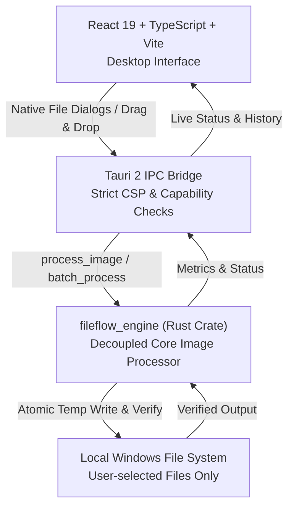

# Zcloud FileFlow — Phase 1 Documentation

Welcome to the **Phase 1** documentation for **Zcloud FileFlow**, a Windows-first, privacy-focused, offline-capable desktop productivity application.

## 1. Scope & Objective
Phase 1 delivers a fully offline, local desktop application for Windows 10/11 providing essential image operations without internet connectivity, external servers, mandatory accounts, subscriptions, or telemetry:
- **Format Conversion**: Convert between PNG, JPG/JPEG, WebP, and BMP.
- **Image Resizing**: Custom width and height configuration, aspect ratio preservation lock, and configurable resampling algorithms (Lanczos3, Bilinear/Triangle, Nearest Neighbor).
- **Image Compression**: Configurable quality scale (1–100%) for JPEG and WebP, lossless WebP encoding, and PNG compression modes (Fast, Default, Best).
- **Batch Processing**: Multi-file queue with drag-and-drop, destination directory selection, live progress feedback, error continuation, and safe cancellation.
- **Output Validation & Safe Writing**: Atomic write pipeline via temporary files to prevent corrupted outputs, plus post-write decode verification.
- **JPEG Transparency Handling**: RGBA alpha channels are composited over a solid white background to avoid black artifacting or encoder crashes.
- **Local Recent History**: Persisted in local WebView storage with search, file existence verification, individual entry removal, and a non-destructive clear-history action.
- **Privacy Disclosures & Transparent Storage**: Complete transparency on stored metadata; zero cloud uploads; explicit documentation on optional Google Sign-in.

---

## 2. Architecture Overview



### 2.1 Technology Stack
- **Desktop Shell**: Tauri 2
- **Backend / Core Engine**: Rust 2021 Edition (`crates/image_engine`, `src-tauri`)
- **Image Processing Library**: `image` crate (v0.25) with native formats (`png`, `jpeg`, `webp`, `bmp`)
- **Serialization**: `serde` (v1.0) with derive macros
- **Frontend UI**: React 19, TypeScript ~5.6, Vite 6, `lucide-react`
- **Testing**:
  - Rust: Native Rust unit test runner in `crates/image_engine` (12 tests)
  - Frontend: `vitest` with `jsdom` and `@testing-library/react` (11 tests)

---

## 3. Setup & Development Instructions

### 3.1 Prerequisites
- **Node.js**: v20 or v22 LTS
- **Rust**: Stable toolchain (`x86_64-pc-windows-msvc` for Windows desktop packaging; or MinGW GCC for engine development)
- **Windows Build Prerequisites**: Microsoft C++ Build Tools or Visual Studio (Desktop development with C++) and WebView2 runtime.

### 3.2 Running the Application Locally
In PowerShell:

```powershell
# 1. Install dependencies
npm ci

# 2. Run automated test suites
npm run test                                           # Frontend tests (Vitest)
cargo test --manifest-path crates/image_engine/Cargo.toml # Rust image engine tests

# 3. Build frontend bundle
npm run build

# 4. Launch Tauri desktop app in development mode
npm run tauri dev
```

### 3.3 Building the Production Installer
To generate the Windows installer (`.msi` and `.exe` NSIS installer):

```powershell
npm run tauri build
```

Generated installer artifacts are placed in:
`src-tauri/target/release/bundle/nsis/`
`src-tauri/target/release/bundle/msi/`

---

## 4. Feature Matrix Status (Phase 1)

| Feature | Scope / Requirements | Status | Verification |
| :--- | :--- | :--- | :--- |
| **PNG/JPG/WebP/BMP Conversion** | Bidirectional conversion between all 4 formats | **Complete** | Automated Rust unit tests & frontend tests |
| **Atomic Output Writing** | Write to temp file, verify, then rename | **Complete** | Automated in `fileflow_engine::process_single_image` |
| **Output Decode Verification** | Post-write decode check to ensure decodable file | **Complete** | `fileflow_engine::verify_output_file` |
| **JPEG Transparency Flattening** | Blend transparent alpha onto white RGB background | **Complete** | Unit test `test_png_to_jpeg_with_transparency_flattening` |
| **Image Resizing** | Width, height, aspect ratio lock, filters | **Complete** | Unit test `test_resize_preserving_aspect_ratio` & UI controls |
| **Image Compression** | Quality slider (1-100), PNG modes, WebP lossless | **Complete** | `fileflow_engine` encoders & UI sliders |
| **Batch Processing Queue** | Multi-file queue, per-item status, cancel, summary | **Complete** | Unit test `test_batch_processing_continues_on_failure` & Batch UI |
| **Recent History Persistence** | Stored locally in WebView storage, survives restart | **Complete** | Tested in `src/App.test.tsx` |
| **Missing File Detection** | Validate if previous files still exist on disk | **Complete** | `check_file_exists` IPC command & UI indicator |
| **Clear History Action** | Clears metadata without touching actual files | **Complete** | Tested in `src/App.test.tsx` |
| **Offline Execution** | Zero cloud dependence, no remote fonts or assets | **Complete** | Bundled assets, zero telemetry, local IPC only |
| **Google Sign-In Placeholder** | Disclosed as unconfigured, instructions provided | **Complete** | Documented in UI Settings and Phase 1 reports |
| **Windows CI Installer Build** | GitHub Actions workflow for installer generation | **Complete** | `.github/workflows/windows-build.yml` with test steps |
